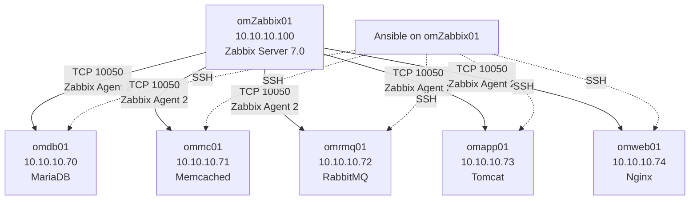

# Zabbix Monitoring Lab

A small infrastructure-monitoring lab using **Zabbix 7.0**, **Zabbix Agent 2**, and **Ansible** to monitor five Ubuntu virtual machines.

> This repository documents the monitoring deployment. It does not contain credentials, SSH private keys, database passwords, or Zabbix secrets.

## Environment

### Monitoring server

| Component | Value |
|---|---|
| Hostname | `omZabbix01` |
| IP address | `10.10.10.100` |
| OS | Ubuntu Server 22.04 LTS |
| Zabbix Server | 7.0.32 |
| Database | MySQL 8.0 |
| Web server | Apache2 |

### Monitored hosts

| Hostname | IP address | Workload |
|---|---:|---|
| `omdb01` | `10.10.10.70` | MariaDB |
| `ommc01` | `10.10.10.71` | Memcached |
| `omrmq01` | `10.10.10.72` | RabbitMQ |
| `omapp01` | `10.10.10.73` | Tomcat |
| `omweb01` | `10.10.10.74` | Nginx |

## Architecture



## What was implemented

- Installed and configured Zabbix Server 7.0.32 on `omZabbix01`.
- Configured the Zabbix frontend and MySQL database.
- Created SSH key-based access from the Ansible control node to the five Linux hosts.
- Installed Ansible on the Zabbix server.
- Deployed Zabbix Agent 2 to all five monitored hosts.
- Configured the agents to accept passive checks from `10.10.10.100`.
- Opened TCP port `10050` in UFW on the four hosts where the rule was missing. Access is restricted to the Zabbix server IP.
- Imported the official Zabbix 7.0 Linux template and linked `Linux by Zabbix agent` to all five hosts.
- Verified agent availability in the Zabbix frontend.

## Ports

| Port | Protocol | Purpose |
|---:|---|---|
| 22 | TCP | SSH / Ansible administration |
| 10050 | TCP | Zabbix Agent 2 passive checks |
| 10051 | TCP | Zabbix Server listener for active agent checks (only if active checks are used) |
| 80/443 | TCP | Zabbix web frontend, depending on web configuration |

The existing Nagios/NRPE setup was left in place. NRPE uses TCP `5666`; Zabbix Agent 2 uses TCP `10050`.

## Repository layout

```text
Zabbix-Monitoring/
├── README.md
├── .gitignore
├── ansible/
│   ├── inventory.ini.example
│   └── install_zabbix_agent.sh
└── docs/
    ├── ansible-deployment.md
    ├── monitoring-setup.md
    └── architecture.md
```

## Deployment notes

1. Review `ansible/inventory.ini.example` and adjust host addresses and SSH user for your environment.
2. Generate an SSH key on the Ansible control node and distribute its public key to the target hosts.
3. Install Ansible on the control node.
4. Run the deployment commands in [`docs/ansible-deployment.md`](docs/ansible-deployment.md).
5. Create the hosts in the Zabbix frontend and link the Linux template as described in [`docs/monitoring-setup.md`](docs/monitoring-setup.md).

## Validation

From the Zabbix/Ansible server:

```bash
nc -zvw3 10.10.10.70 10050
zabbix_get -s 10.10.10.70 -k agent.ping
```

Expected `agent.ping` response:

```text
1
```

Repeat for the other four monitored host IPs.

## Important security notes

- Never commit private SSH keys, passwords, API tokens, database credentials, or unredacted configuration files.
- Restrict TCP `10050` to the Zabbix server address, rather than opening it to every source.
- Use a supported Ubuntu LTS release for production systems. The monitored lab VMs were running Ubuntu 25.10 at the time this lab was configured; plan an upgrade because interim Ubuntu releases have a short support lifecycle.
- This repository is a deployment record and starting point. Review commands and environment-specific values before reusing them.
